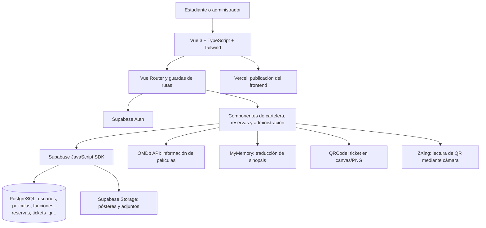

[README.md](https://github.com/user-attachments/files/34864363/README.md)


# 🎬 Cine ULEAM — Plataforma de cartelera, reservas y control de acceso

> Proyecto de hackatón para la Universidad Laica Eloy Alfaro de Manabí (ULEAM). Este README distingue **funciones presentes en el código**, **dependencias externas**, **decisiones técnicas inferidas** y **contribuciones personales respaldadas por commits**, para que un asistente con RAG no invente información.

**Repositorio:** https://github.com/DavidJaramillo132/HakatonCine  
**Frontend:** [`cine-uleam-frontend/`](https://github.com/DavidJaramillo132/HakatonCine/tree/main/cine-uleam-frontend)  
**Demo publicada en la descripción de GitHub:** https://hakaton-cine.vercel.app/  
**Estado de la demo:** existe una URL pública asociada al repositorio; no se han verificado con credenciales los flujos de reserva y administración en producción.

## 1. Resumen y demo

**Cine ULEAM** es una aplicación web para la comunidad universitaria que permite consultar la cartelera, registrarse con correo institucional, reservar cupos para funciones y obtener entradas representadas por códigos QR. Incluye herramientas administrativas para mantener películas, salas y horarios, validar el ingreso de asistentes y consultar estadísticas, además de módulos de sugerencias, encuestas y solicitudes de alquiler de sala.

### Demo

- **Aplicación web:** [hakaton-cine.vercel.app](https://hakaton-cine.vercel.app/).
- **Código fuente:** [HakatonCine en GitHub](https://github.com/DavidJaramillo132/HakatonCine).
- **Capturas:** [galería de Cine ULEAM en el portafolio](https://portafolio-mocha-psi.vercel.app/projects/cine).
- **Recorrido demostrable:** registro/inicio de sesión → cartelera → selección de función → creación de reserva y QR → escaneo y validación desde el panel de administración.

### Funcionalidades respaldadas por componentes del repositorio

| Funcionalidad | Roles o usuarios | Evidencia en código | Estado documental |
| --- | --- | --- | --- |
| Registro e inicio de sesión institucional | Estudiantes y administradores | [`Register.vue`](cine-uleam-frontend/src/components/Register.vue), [`Login.vue`](cine-uleam-frontend/src/components/Login.vue) | Implementación visible; requiere Supabase configurado |
| Recuperación y restablecimiento de contraseña | Usuarios | [`ForgotPassword.vue`](cine-uleam-frontend/src/components/ForgotPassword.vue), [`ResetPassword.vue`](cine-uleam-frontend/src/components/ResetPassword.vue) | Rutas/componentes presentes |
| Cartelera, filtros y detalles | Usuarios autenticados | [`Cartelera.vue`](cine-uleam-frontend/src/components/Cartelera.vue) | Implementación visible |
| Reservas y descarga de ticket QR | Usuarios autenticados | [`GeneradorQR.vue`](cine-uleam-frontend/src/components/GeneradorQR.vue) | Implementación visible; persiste en Supabase |
| Escaneo y confirmación de entrada | Administradores | [`EscanerQR.vue`](cine-uleam-frontend/src/components/EscanerQR.vue) | Implementación visible; depende de cámara, datos y permisos |
| Gestión de películas y programación | Administradores | [`AdminCartelera.vue`](cine-uleam-frontend/src/components/AdminCartelera.vue) | Implementación visible |
| Gestión de salas | Administradores | [`AdminSalas.vue`](cine-uleam-frontend/src/components/AdminSalas.vue) | Implementación visible |
| Indicadores administrativos de ocupación | Administradores | [`AdminDashboard.vue`](cine-uleam-frontend/src/components/AdminDashboard.vue) | Implementación visible |
| Sugerencias de películas y revisión de notificaciones | Estudiantes y administradores | [`Sugerencia.vue`](cine-uleam-frontend/src/components/Sugerencia.vue), [`AdminNotificaciones.vue`](cine-uleam-frontend/src/components/AdminNotificaciones.vue) | Implementación visible |
| Encuestas y votaciones | Estudiantes y administradores | [`EncuestasEstudiante.vue`](cine-uleam-frontend/src/components/EncuestasEstudiante.vue), [`AdminEncuestas.vue`](cine-uleam-frontend/src/components/AdminEncuestas.vue) | Implementación visible |
| Solicitud, aprobación y rechazo de alquiler de sala | Usuarios y administradores | [`AlquilerSala.vue`](cine-uleam-frontend/src/components/AlquilerSala.vue) | Implementación visible; archivos mediante Supabase Storage |

**Distinción importante:** «implementación visible» significa que existe lógica en el repositorio, **no** que se haya ejecutado una prueba completa contra el proyecto Supabase de producción.

## 2. Mi contribución y trabajo en equipo

Cine ULEAM fue un proyecto de hackatón con varios contribuyentes. En el historial, la cuenta de David Jaramillo registra el [cambio para subir pósteres desde la cartelera administrativa](https://github.com/DavidJaramillo132/HakatonCine/commit/cc5f27208ef530128fe3d36cd7c33c6bcc24db75), con su guía de pruebas, y una [actualización al formulario de recuperación de contraseña](https://github.com/DavidJaramillo132/HakatonCine/commit/922c0fb136c422c685e9c757df0d3ed07ff7366e).

La evidencia identifica esas contribuciones. El [historial del equipo](https://github.com/DavidJaramillo132/HakatonCine/graphs/contributors) no permite atribuirle por sí solo todo el sistema de reservas, el escáner o el diseño de la base de datos.

## 3. Arquitectura y flujo principal

### Arquitectura observada

La aplicación es una **SPA** (single-page application) de Vue 3 compilada con Vite. No se observa un servidor API propio dentro de la raíz de este repositorio: el navegador usa el SDK de Supabase para autenticación, consultas de PostgreSQL y almacenamiento de archivos. Además, ciertas vistas consultan servicios públicos de películas y traducción.



**Lectura del diagrama:** Vercel sirve el frontend, pero no sustituye a Supabase ni confirma la existencia de un backend propio. Las reglas de autorización de los datos dependen de la configuración real de Supabase, incluida Row Level Security (RLS), no solamente de las guardas del router.

**Archivos de entrada y conexión:** [`main.ts`](cine-uleam-frontend/src/main.ts), [`App.vue`](cine-uleam-frontend/src/App.vue), [`router.ts`](cine-uleam-frontend/src/router/router.ts) y [`connectSupabase.ts`](cine-uleam-frontend/src/lib/connectSupabase.ts).

### Flujo principal: de seleccionar una película a validar su entrada

1. El usuario visita `/register` o `/login`. El registro utiliza `supabase.auth.signUp` y exige en el formulario un correo que termine en `@live.uleam.edu.ec`; el acceso utiliza `signInWithPassword`. El código de registro **espera que exista** un trigger externo `handle_new_user()` para crear el registro de perfil en `usuarios`.
2. El navegador navega por Vue Router. Las guardas comprueban la sesión Supabase y roles utilizados por la interfaz; **la protección del lado del servidor debe reforzarse con políticas RLS**.
3. En `/cartelera`, el componente consulta `peliculas` en Supabase y aplica filtros de título y género. Al elegir la reserva, se abre la ruta `/generar-qr` con la película seleccionada.
4. En `/generar-qr`, el usuario elige una función y una cantidad de asientos. El frontend consulta `usuarios`, `peliculas` y `funciones`, crea una fila en `reservas` con estado `activa` y obtiene el ID resultante.
5. El frontend arma un objeto JSON con el ID de la reserva y datos de la función/persona; lo inserta en `tickets_qr` con estado `activo`, lo transforma en un QR visible con la biblioteca `qrcode` y permite descargar un archivo PNG.
6. Un administrador abre `/escanear-qr`; ZXing lee el código con la cámara. La aplicación extrae el ID de reserva, consulta `tickets_qr` en Supabase y rechaza los tickets marcados como usados o expirados.
7. Al confirmar el acceso, el escáner actualiza `tickets_qr.estado` a `usado` y `reservas.estado` a `asistida`. Así, el resultado del proceso queda registrado en PostgreSQL.

**Datos de entrada:** correo, contraseña, película, función, número de asientos y QR presentado.  
**Procesamiento:** componentes Vue → consultas/escrituras con Supabase → generación/lectura local de QR.  
**Resultado persistente:** registros en `reservas` y `tickets_qr`; modificaciones de estado cuando se valida el acceso.

**Referencias directas:** [`Login.vue`](cine-uleam-frontend/src/components/Login.vue), [`Register.vue`](cine-uleam-frontend/src/components/Register.vue), [`Cartelera.vue`](cine-uleam-frontend/src/components/Cartelera.vue), [`GeneradorQR.vue`](cine-uleam-frontend/src/components/GeneradorQR.vue), [`EscanerQR.vue`](cine-uleam-frontend/src/components/EscanerQR.vue).

### Flujos secundarios

- **Administración de películas:** crear/editar/eliminar películas manualmente o consultar OMDb; obtener los datos de una película y traducir su sinopsis con MyMemory; guardar la ficha en `peliculas`; opcionalmente subir el póster al bucket `posters-peliculas` de Supabase Storage. Código: [`AdminCartelera.vue`](cine-uleam-frontend/src/components/AdminCartelera.vue).
- **Programación de funciones:** administrar asociaciones película–sala–horario en `funciones` mediante la interfaz administrativa; el código de administración realiza validaciones de horario. Código: [`AdminCartelera.vue`](cine-uleam-frontend/src/components/AdminCartelera.vue).
- **Sugerencias:** el estudiante busca una película y envía una propuesta; el administrador gestiona las notificaciones de tipo `recomendacion`. Código: [`Sugerencia.vue`](cine-uleam-frontend/src/components/Sugerencia.vue) y [`AdminNotificaciones.vue`](cine-uleam-frontend/src/components/AdminNotificaciones.vue).
- **Encuestas:** el administrador crea preguntas y consulta votos (`encuestas`, `votos`); el estudiante responde y consulta las encuestas disponibles. Código: [`AdminEncuestas.vue`](cine-uleam-frontend/src/components/AdminEncuestas.vue) y [`EncuestasEstudiante.vue`](cine-uleam-frontend/src/components/EncuestasEstudiante.vue).
- **Alquiler de sala:** el usuario envía una solicitud (`alquiler_eventos`), opcionalmente con un archivo adjunto guardado en Supabase Storage; el administrador puede aprobarla o rechazarla. Código: [`AlquilerSala.vue`](cine-uleam-frontend/src/components/AlquilerSala.vue).

### Entidades y almacenamiento

| Recurso | Propósito | Nivel de evidencia |
| --- | --- | --- |
| `usuarios` | Perfil y rol de usuario | Consultado por registro, router y reserva |
| `peliculas` | Cartelera y metadatos de películas | Lectura y escritura desde frontend |
| `salas` | Salas del recinto | Consultada por componentes administrativos |
| `funciones` | Proyección de una película en una sala y horario | Lectura y escritura |
| `reservas` | Cupos reservados y estado de asistencia | Inserción y actualización |
| `tickets_qr` | Datos y estado de códigos de entrada | Inserción, búsqueda y actualización |
| `notificaciones` | Sugerencias gestionables | Lectura y actualización |
| `encuestas`, `votos` | Preguntas y respuestas de estudiantes | Lectura y escritura |
| `alquiler_eventos`, `alquiler_archivos` | Solicitudes de alquiler y adjuntos | Lectura y escritura |
| Storage `posters-peliculas` | Pósteres subidos por administración | Operaciones de upload/public URL |
| Storage `alquiler-archivos` | Archivos adjuntos a una solicitud | Operaciones de upload/URL |

**Importante:** esta tabla describe **usos observados desde el frontend**, no un esquema SQL exhaustivo. El README original menciona una tabla `sala` (singular), mientras que el código de administración consulta `salas` (plural): antes de recrear la base de datos hay que validar el esquema real. No se ha verificado en esta revisión un juego completo de migraciones SQL ni las políticas RLS.

## 4. Decisiones técnicas: qué problema resuelve cada tecnología

### Vue 3 + TypeScript + Vue Router

- **Problema abordado:** construir varias pantallas y flujos diferenciados (estudiante/administrador) dentro de una aplicación web interactiva.
- **Uso comprobable:** componentes `.vue`, tipado de estructuras de datos e interfaces, navegación por rutas y carga diferida de pantallas en [`router.ts`](cine-uleam-frontend/src/router/router.ts).
- **Implicación técnica:** organización modular del frontend y validación de tipos durante el build; las guardas de rutas facilitan la experiencia, pero **no reemplazan la autorización de la base de datos**.
- **Motivación histórica:** inferida por la arquitectura; no consta una declaración del equipo sobre por qué eligió Vue frente a otros frameworks.

### Supabase (Auth, PostgreSQL y Storage)

- **Problema abordado:** autenticar usuarios, persistir reservas y consultar datos sin mantener un servidor de aplicación propio en este repositorio.
- **Uso comprobable:** [`connectSupabase.ts`](cine-uleam-frontend/src/lib/connectSupabase.ts) crea el cliente; los componentes usan `supabase.auth`, `.from(...)` y `.storage`.
- **Implicación técnica:** desarrollo más rápido para un prototipo de hackatón, con dependencia de un proyecto Supabase externo, sus tablas, triggers, buckets y políticas RLS. **No se debe afirmar que se diseñó personalmente PostgreSQL sin evidencia de autoría.**

### QRCode + ZXing

- **Problema abordado:** conectar una reserva digital con la admisión presencial a la función.
- **Uso comprobable:** [`GeneradorQR.vue`](cine-uleam-frontend/src/components/GeneradorQR.vue) utiliza `QRCode.toCanvas` y descarga PNG; [`EscanerQR.vue`](cine-uleam-frontend/src/components/EscanerQR.vue) usa `BrowserMultiFormatReader` para leer desde la cámara y consultar la reserva.
- **Implicación técnica:** el usuario puede presentar un ticket visual en su dispositivo; la validación real del acceso exige consultar el estado guardado en Supabase. El QR actual contiene datos personales en texto JSON, algo a revisar en futuras iteraciones.

### Otras elecciones relevantes

- **Vite 7 + Tailwind CSS 4:** compilación/servidor de desarrollo y estilos utilitarios. [`package.json`](cine-uleam-frontend/package.json), [`vite.config.ts`](cine-uleam-frontend/vite.config.ts).
- **OMDb:** autocompletado/consulta de información cinematográfica desde el módulo administrativo y sugerencias. [`AdminCartelera.vue`](cine-uleam-frontend/src/components/AdminCartelera.vue).
- **MyMemory Translation API:** traducción de sinopsis al español, con uso del texto original como alternativa cuando falla. [`AdminCartelera.vue`](cine-uleam-frontend/src/components/AdminCartelera.vue).
- **Vercel:** publicación del frontend; [`vercel.json`](cine-uleam-frontend/vercel.json) define reescrituras para navegación de una SPA.

## 5. Cómo ejecutarlo y probarlo

### Requisitos reales

- Git y npm.
- **Node.js 20.19+ o 22.12+** (requisito de Vite 7; el README preexistente menciona Node 18+, pero no es suficiente para Vite 7).
- Proyecto Supabase accesible con URL y clave publicable/`anon`.
- Tablas, relaciones, bucket(s), trigger de perfil y políticas RLS configurados para los flujos que se quieran probar.
- Clave de OMDb si se va a usar la búsqueda de películas de ese proveedor.
- Para escanear QR: navegador compatible y permiso de cámara; en dispositivos remotos, contexto seguro HTTPS.

### 5.1. Clonar e instalar

```bash
git clone https://github.com/DavidJaramillo132/HakatonCine.git
cd HakatonCine/cine-uleam-frontend
node --version
npm ci
```

El repositorio contiene `package-lock.json`, por lo que `npm ci` es preferible para instalar las versiones bloqueadas.

### 5.2. Configuración sin secretos

Crear `cine-uleam-frontend/.env.local` (archivo local, no subir credenciales privadas a Git):

```dotenv
# Valores de ejemplo; reemplazar por los de TU proyecto Supabase.
VITE_SUPABASE_URL=https://tu-proyecto.supabase.co
VITE_SUPABASE_ANON_KEY=tu-clave-publicable-o-anon

# Necesaria para funciones que consultan OMDb.
VITE_OMDB_API_KEY=tu-clave-de-omdb
```

**Seguridad:** todas las variables `VITE_*` quedan disponibles en el bundle del navegador. Solo introducir claves destinadas al frontend; **nunca** una `service_role`, contraseña de base de datos, token secreto o clave privada. La protección de los datos exige políticas RLS adecuadas, aunque el frontend oculte ciertas rutas.

**Dependencia no incluida en este README:** no se proporciona aquí un script SQL reproducible del esquema completo. La aplicación espera una base con entidades y reglas coincidentes con las consultas del código, así como el trigger `handle_new_user()` mencionado por `Register.vue`. No bastan las tres variables anteriores para que funcionen todos los módulos.

### 5.3. Arrancar y compilar

```bash
# Desarrollo
npm run dev

# Verificación de tipos y compilación (vue-tsc + Vite)
npm run build

# Vista previa de la compilación
npm run preview
```

Normalmente, Vite mostrará un enlace local como `http://localhost:5173/`; usar la URL concreta que indique la terminal si el puerto cambia.

### 5.4. Prueba funcional manual sugerida

1. **Inicio de la aplicación:** abrir la URL local y comprobar que se renderizan la página de inicio y la navegación.
2. **Autenticación:** probar inicio de sesión con una cuenta de prueba institucional válida de Supabase y verificar que carga el perfil; probar la redirección de una ruta protegida sin sesión.
3. **Cartelera:** acceder a `/cartelera`, comprobar que se consultan películas y que funcionan búsqueda y filtros.
4. **Reserva:** con una función futura disponible, seleccionar una película, establecer el número de asientos y generar un QR; comprobar en Supabase que existen la reserva `activa` y el ticket `activo` asociados.
5. **Validación:** entrar con un usuario autorizado al módulo `/escanear-qr`, escanear el ticket generado, confirmar y revisar en Supabase que el ticket pasa a `usado` y la reserva a `asistida`. Volver a intentar usarlo para comprobar el rechazo.
6. **Administración:** ingresar con una cuenta administradora y comprobar alta de película, consulta de funciones, gestión de salas y lectura del dashboard.
7. **Módulos complementarios:** probar una encuesta, una sugerencia y una solicitud de alquiler en una base de pruebas; verificar los registros correspondientes.

**Cuidado con los datos de pruebas:** la reserva y validación modifican registros reales de la base configurada; usar un proyecto Supabase de desarrollo, no datos de producción. Para evaluar autorización, intentar accesos indebidos sobre tablas mediante las políticas RLS, no solo navegar a rutas protegidas.

### Pruebas automatizadas

El `package.json` revisado incluye scripts `dev`, `build` y `preview`; **no declara un script `test`**. Por tanto, `npm run build` sirve como comprobación de tipos y empaquetado, pero **no equivale a pruebas unitarias ni de extremo a extremo**. No se afirma aquí una cobertura o una ejecución de pruebas que no se haya observado.

## 6. Limitaciones, riesgos y pendientes

### Implementado en el repositorio (código visible)

- Interfaces y lógica del frontend para registro, login, cartelera, reserva y emisión/lectura de QR.
- Paneles para películas, funciones, salas, estadísticas, encuestas y sugerencias.
- Solicitudes de alquiler de sala con acciones de aprobación/rechazo y adjuntos.
- Integraciones de cliente con Supabase, OMDb, MyMemory y Storage.

### No verificado de extremo a extremo

- **Esquema SQL reproducible:** los componentes asumen tablas, columnas y un trigger de usuario cuya definición no se ha comprobado íntegramente en el repositorio.
- **Políticas de seguridad Supabase/RLS:** no deben deducirse de las guardas Vue ni de los roles que se guardan en `localStorage`.
- **Control de aforo y concurrencia:** el flujo de reserva inserta una cantidad de asientos; sin lógica transaccional de backend/SQL comprobada, no puede garantizarse que dos solicitudes simultáneas respeten la capacidad.
- **Emisión atómica de reserva + ticket:** son inserciones separadas desde el navegador; si falla la segunda, puede quedar una reserva sin ticket.
- **QR seguro:** el QR se construye como JSON que incluye nombre, correo, carrera y otros datos. El lector verifica la existencia/estado por `reserva_id` en lugar de contrastar el contenido completo con una firma criptográfica; conviene sustituir esos datos por un token opaco de validación y comprobarlo de forma atómica en el servidor.
- **Autorización robusta:** comprobar que RLS impida editar tickets, reservas, roles y solicitudes desde clientes no autorizados. Una guarda de ruta no es un límite de seguridad.
- **Demo en producción:** la URL está referenciada públicamente, pero aquí no se acreditan pruebas con cuentas y permisos de producción ni disponibilidad futura.
- **Tests:** no hay script `test` en el manifiesto examinado.

### Mejoras pendientes declaradas en el README original

- Notificaciones por correo.
- Favoritos e historial de reservas.
- Reportes avanzados.
- Reseñas y calificaciones.
- Integración de pagos.

Estos puntos se registran como **propuestas/pedientes del README original**, no como funcionalidades ya implementadas.

### Mejoras recomendadas para robustez técnica

- Versionar migraciones SQL, constraints, políticas RLS, buckets y triggers necesarios para levantar un entorno reproducible.
- Mover la creación/confirmación de reservas y tickets a operaciones transaccionales y validar aforo/duplicados en la base de datos.
- Evitar PII en los QR; aplicar tokens opacos o firmados, verificación con expiración y canje atómico contra la base.
- Añadir pruebas unitarias, pruebas de integración con Supabase de desarrollo y pruebas E2E del flujo de reservas.
- Revisar accesos basados en `localStorage`, y autorización de roles a nivel RLS o mediante un servicio de confianza.

## 7. Referencias técnicas y puntos de entrada

| Necesidad | Archivo/enlace |
| --- | --- |
| Iniciar aplicación | [`src/main.ts`](cine-uleam-frontend/src/main.ts) |
| Layout y montaje de vistas | [`src/App.vue`](cine-uleam-frontend/src/App.vue) |
| Rutas, roles y navegación | [`src/router/router.ts`](cine-uleam-frontend/src/router/router.ts) |
| Configuración Supabase | [`src/lib/connectSupabase.ts`](cine-uleam-frontend/src/lib/connectSupabase.ts) |
| Registro e inicio de sesión | [`src/components/Register.vue`](cine-uleam-frontend/src/components/Register.vue), [`Login.vue`](cine-uleam-frontend/src/components/Login.vue) |
| Cartelera | [`src/components/Cartelera.vue`](cine-uleam-frontend/src/components/Cartelera.vue) |
| Crear reserva y QR | [`src/components/GeneradorQR.vue`](cine-uleam-frontend/src/components/GeneradorQR.vue) |
| Validación de entrada | [`src/components/EscanerQR.vue`](cine-uleam-frontend/src/components/EscanerQR.vue) |
| Administración de películas y funciones | [`src/components/AdminCartelera.vue`](cine-uleam-frontend/src/components/AdminCartelera.vue) |
| Gestión de salas, encuestas y alquiler | [`AdminSalas.vue`](cine-uleam-frontend/src/components/AdminSalas.vue), [`AdminEncuestas.vue`](cine-uleam-frontend/src/components/AdminEncuestas.vue), [`AlquilerSala.vue`](cine-uleam-frontend/src/components/AlquilerSala.vue) |
| Scripts y versiones | [`package.json`](cine-uleam-frontend/package.json), [`package-lock.json`](cine-uleam-frontend/package-lock.json) |
| Despliegue | [`vite.config.ts`](cine-uleam-frontend/vite.config.ts), [`vercel.json`](cine-uleam-frontend/vercel.json) |
| Documentación preexistente | [`cine-uleam-frontend/README.md`](cine-uleam-frontend/README.md) |

**Documentación de terceros:** [Vue](https://vuejs.org/guide/introduction.html) · [Supabase JS](https://supabase.com/docs/reference/javascript/introduction) · [Supabase RLS](https://supabase.com/docs/guides/database/postgres/row-level-security) · [Vite 7 y requisitos Node](https://v7.vite.dev/guide/migration) · [OMDb API](https://www.omdbapi.com/) · [ZXing Browser](https://github.com/zxing-js/browser).

## 8. Contexto listo para RAG

> Esta sección se diseñó para sistemas de recuperación semántica. Cada encabezado representa un fragmento autónomo potencial; al indexar, conservar `project_id`, `repository`, `source_directory`, `review_date` y `contribution_status` como metadatos.

### Ficha factual: identidad y propósito

- **Proyecto:** Cine ULEAM.
- **Repositorio:** `DavidJaramillo132/HakatonCine`.
- **Tipo:** aplicación web universitaria desarrollada en contexto de hackatón.
- **Usuarios:** estudiantes de la ULEAM y administradores del cine.
- **Problema:** digitalización de cartelera, solicitudes de reserva, emisión de entradas QR y control de acceso.
- **Resultado:** SPA con flujo de reserva y comprobación de tickets conectado a Supabase.
- **Autoría personal:** cambios verificados descritos en la sección 2.

### Ficha factual: tecnologías y responsabilidades

- **Vue 3 + TypeScript:** componentes, formularios, interacción y tipos del cliente.
- **Vue Router:** navegación, carga diferida y guardas de UI según sesión/rol.
- **Supabase Auth:** registro e inicio de sesión.
- **Supabase/PostgreSQL:** registros de películas, funciones, reservas y tickets.
- **Supabase Storage:** imágenes de películas y archivos de alquiler.
- **QRCode:** construcción de QR y descarga como PNG.
- **ZXing:** lectura de QR mediante cámara.
- **OMDb y MyMemory:** metadatos de películas y traducción de sinopsis.
- **Vite/Tailwind/Vercel:** herramientas de construcción, estilos y despliegue del frontend.

### Preguntas frecuentes para recuperación

**¿Qué hace HakatonCine?** Es una plataforma web de cine universitario en la que los usuarios pueden consultar películas, reservar cupos y generar entradas QR; los administradores gestionan cartelera, salas, horarios y entradas.

**¿Cómo funciona una reserva?** El usuario selecciona película y función; `GeneradorQR.vue` inserta una reserva en Supabase, luego un registro de ticket QR, renderiza un código QR y permite descargarlo.

**¿Dónde se almacenan las reservas?** En la tabla `reservas` de la base PostgreSQL gestionada por Supabase, mediante el SDK JavaScript usado por el frontend.

**¿Cómo se comprueba una entrada?** `EscanerQR.vue` lee el código con ZXing, busca su `reserva_id` en `tickets_qr` y, tras confirmación, marca el ticket `usado` y la reserva `asistida`.

**¿Existe backend en Java, Node o Python?** En este repositorio se documenta un frontend Vue conectado directamente a Supabase. No debe inventarse una API de aplicación propia ni afirmar que existe un backend independiente sin una fuente adicional.

**¿Qué desarrolló personalmente David?** El historial confirma cambios de David en la carga de pósteres y en el formulario de recuperación de contraseña. El resto de la autoría individual no está documentado aquí.

**¿Está listo para producción?** El frontend tiene URL de demo y funcionalidades implementadas en código, pero no están verificadas aquí las políticas RLS, la atomicidad del canje de tickets, la prevención de sobre-reservas ni los tests E2E; no afirmarlo como sistema auditado para producción.

### Reglas para un asistente que consulte este documento

1. Separar «el proyecto usa» de «yo desarrollé»; para lo segundo exigir evidencia en la sección de contribución.
2. Citar como fuentes principales los archivos enlazados en cada funcionalidad.
3. No afirmar que existe un backend propio, SQL completo, políticas RLS certificadas, una cobertura de tests o pagos implementados sin evidencia adicional.
4. Tratar la demo como enlace asociado, no como prueba de que todo funciona hoy.
5. Cuando falte contexto de autoría o infraestructura, explicar qué está confirmado y qué no.
6. Evitar indexar valores `.env`, claves, datos de usuario reales o tokens de acceso en la base vectorial.

---

**Estado de revisión:** análisis estático de archivos públicos del repositorio `main` y su README existente, realizado el 14 de noviembre de 2026. No se ha ejecutado la aplicación ni se ha accedido a la instancia Supabase privada; el comportamiento en producción puede diferir del código revisado.
